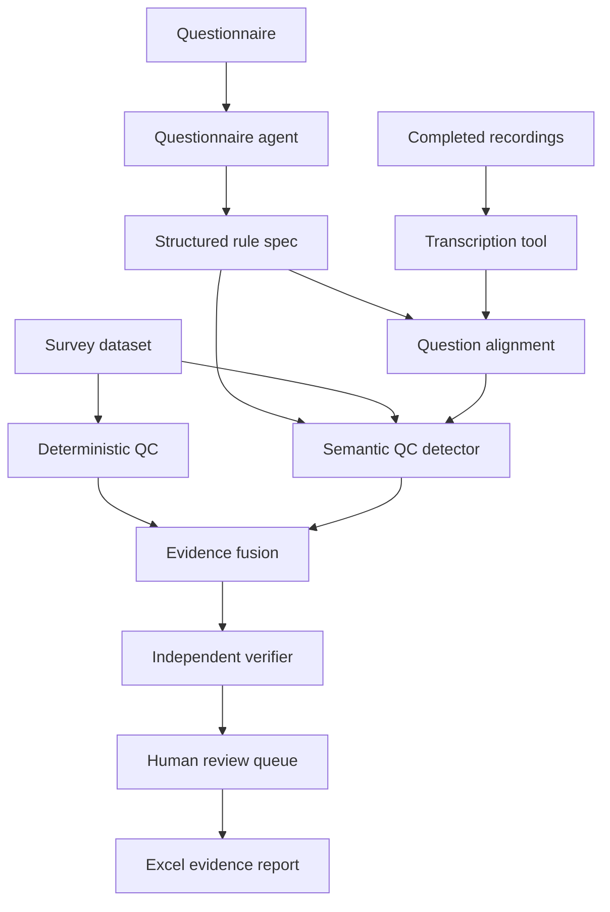

# SurveyGuard by Servallab

Agentic multimodal quality control for survey research.

SurveyGuard reads a questionnaire, converts administration instructions into an auditable rule specification, checks the captured dataset with deterministic code, aligns completed interview recordings to the questionnaire, compares spoken answers with captured values and verbatims, independently verifies candidate issues, and produces a reviewer-ready evidence report.

The transcription engine is a tool, not an agent. It supplies timestamped evidence; the QC and verification components decide what that evidence does and does not prove.

## Why this exists

Survey QC teams currently move between three sources:

1. questionnaire wording, codes, probes, consent, and routing;
2. the captured CSV/XLSX/SAV dataset; and
3. completed interview recordings.

A row can pass every database validation and still be wrong. For example, code `1` may mean *increase* while the respondent clearly says production decreased. SurveyGuard joins those evidence streams without automatically accusing or penalising an interviewer.

## What the submitted system does

- Loads CSV, TSV, XLSX, XLS, SAV, and Parquet survey data.
- Extracts questionnaire rules from TXT, Markdown, JSON, PDF, and DOCX.
- Transcribes WAV/MP3/M4A/OGG/FLAC/WebM/MP4 through Groq Whisper when configured.
- Accepts timestamped JSON, SRT, VTT, or TXT transcripts for a fully key-free demo.
- Preserves supplied speaker labels and uses `unknown` when the transcription provider does not identify a speaker; it never guesses speaker identity.
- Runs deterministic missing, range, duplicate, logic, duration, straightlining, consent, and pattern checks.
- Detects audio–data contradictions, verbatim–audio mismatches, missing questions, changed required wording, leading questions, and insufficient probing.
- Uses a recall-biased detector followed by a stricter independent verifier.
- Returns `confirmed`, `review`, or `rejected` rather than forcing every signal into pass/fail.
- Lets a human confirm, reject, or investigate each finding.
- Exports findings, transcript evidence, and extracted questionnaire rules to Excel.

## Architecture



See [ARCHITECTURE.md](ARCHITECTURE.md) for contracts, thresholds, failure handling, and privacy decisions.

## Run the key-free demo

### Docker

```bash
docker build -t surveyguard .
docker run --rm -p 8000:8000 surveyguard
```

Open `http://localhost:8000`. The **Agentic Audit** tab opens by default. Upload:

- `demo/questionnaire.txt`
- `demo/survey.csv`
- `demo/DEMO001.json`

The demo contains a spoken decrease captured as code `1 = Increase`, a verbatim mismatch, and changed read-exactly wording.

### Local development

```bash
python -m venv .venv
source .venv/bin/activate
pip install -r requirements-api.txt
pip install pytest

cd datasense-ui
npm ci
npm run build
cd ..

uvicorn api:app --host 0.0.0.0 --port 8000
```

Copy `.env.example` to `.env` only for local configuration. Do not commit `.env`.

## Real recordings

Set `GROQ_API_KEY` on the server or enter a key in the app settings. Real audio is sent to Groq's transcription endpoint. Transcript-only audits stay local and require no model key.

## Reproduce the evaluation

```bash
python -m evaluation.run_eval
```

The harness evaluates the same 20 synthetic cases against every stage. Current committed result:

| Version | Precision | Recall | F1 |
|---|---:|---:|---:|
| Single-pass lexical baseline | 0.156 | 0.250 | 0.192 |
| Dataset-only semantic QC | 1.000 | 0.350 | 0.519 |
| Multimodal detector, no verifier | 0.556 | 1.000 | 0.714 |
| Final detector + verifier | 0.556 | 1.000 | 0.714 |

The benchmark also computes an audio-review-window proxy: full recordings total 491 seconds; flag windows request 375 seconds, a 23.6% reduction. This is a deterministic workload proxy, **not** a measured human time study.

These figures prove performance only on the committed, scoped synthetic benchmark. They are not a claim of universal accuracy. Full records are in `evaluation/results/main_eval.json`; representative verified trajectories are in `evaluation/trajectories.json`.

See [evaluation/README.md](evaluation/README.md) for labels, scoring, and limitations, and [CHANGELOG_HACKATHON.md](CHANGELOG_HACKATHON.md) for the iteration log.

## Tests and build

```bash
pytest tests/ -q
python -m evaluation.run_eval
cd datasense-ui && npm ci && npm run build
```

CI runs all three gates. At the time of this submission, the backend suite contains 112 passing tests.

## Important API routes

| Route | Purpose |
|---|---|
| `POST /api/agentic/audits` | Create questionnaire + data + recording audit |
| `GET /api/agentic/audits/{id}/status` | Poll progress |
| `GET /api/agentic/audits/{id}` | Retrieve full evidence report |
| `POST /api/agentic/audits/{id}/findings/{finding}/decision` | Save reviewer decision |
| `GET /api/agentic/audits/{id}/export` | Download Excel evidence report |
| `POST /api/upload` | Upload a dataset for deterministic QC |
| `POST /api/run` | Run the deterministic rule engine |
| `GET /api/results/{job}` | Retrieve deterministic results |
| `GET /docs` | OpenAPI documentation |

## Safety and privacy

- Public evaluation data is 100% synthetic.
- Uploaded audit files live in an isolated temporary directory and are deleted after processing.
- Model/API keys are never returned in API responses or trajectories.
- Findings do not trigger employment, payment, disciplinary, or respondent decisions.
- Leading, probing, and ambiguous semantic findings stay in human review.
- Production refuses to start without an explicit `JWT_SECRET`.
- Production does not seed the known local demo administrator password.

Read [SECURITY.md](SECURITY.md) before deployment.

## Submission materials

- [SUBMISSION.md](SUBMISSION.md) — rubric-facing project summary and evidence map
- [DEMO_SCRIPT.md](DEMO_SCRIPT.md) — five-minute recording script
- [ARCHITECTURE.md](ARCHITECTURE.md) — system design
- [CHANGELOG_HACKATHON.md](CHANGELOG_HACKATHON.md) — experiments and decisions
- `evaluation/results/latest.json` — machine-readable results
- `evaluation/trajectories.json` — representative agent trajectories
